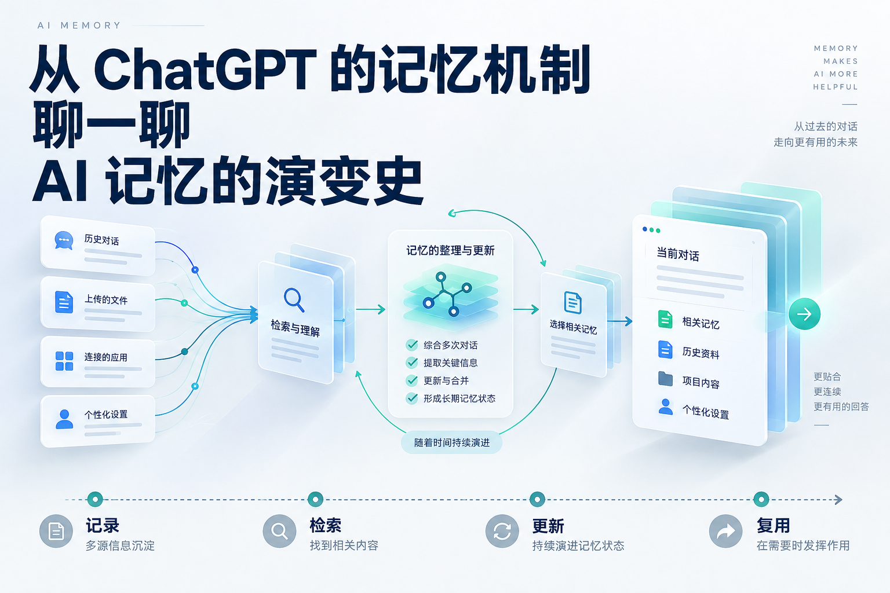

# 从 ChatGPT 的记忆机制，聊一聊 AI 记忆的演变史

*资料核对至 2026 年 9 月 18 日。*

ChatGPT 的长期记忆，涉及两项持续进行的工作：从过去的交互中整理信息，为当前的问题准备背景。前一项决定它怎样理解用户和项目，后一项决定哪些过去的信息会影响这次回答。OpenAI 将其中的后台记忆综合机制称为 **Dreaming**。[^dreaming]

沿着这两项工作往下拆，会遇到 AI 记忆发展的几条主要路线：会话缓存、摘要笔记、向量检索、分层记忆、时间知识图谱，以及能够自行更新的记忆系统。

## 一、ChatGPT 的记忆机制

### 1. 从保存信息，到后台综合

2024 年 2 月，OpenAI 开始测试 ChatGPT 的记忆功能。用户可以明确要求它记住某件事，系统也会从交互中提取有用细节。这一阶段的核心是 **Saved Memories**：将相对稳定的信息保存下来，供后续对话使用。例如，用户的职业背景、常用编程语言和回答偏好。[^memory-launch]

2025 年 4 月，ChatGPT 增加了引用历史聊天的能力。OpenAI 后来将背后的机制解释为第一版 Dreaming：系统在后台参考历史对话，综合有用的长期信息。2026 年 6 月 4 日发布的进一步升级，在官方版本对比中标为 **Dreaming V3**。[^dreaming]

这条演进路线可以概括为：

> **2024：提取并保存具体信息。**  
> **2025：结合历史对话整理记忆。**  
> **2026：持续维护能够反映变化的记忆状态。**

这些升级逐渐完善了跨会话交流的连续性，并将一个更复杂的问题推到前台：人和项目都会变化，记忆也需要跟着变化。

### 2. 存储：从原始记录生成记忆状态

可以把相关数据分成三层。

**原始来源层**保存聊天、文件等材料。**记忆状态层**保存从这些材料中整理出来的长期背景。**当前上下文层**则是模型这次回答时实际获得的信息。ChatGPT 能利用哪些来源，取决于功能和授权；官方列出的来源包括历史聊天、保存的记忆、文件，以及已连接应用中的内容。[^memory-faq]

以一个开发项目为例，假设历史里有三次讨论：

> 3 月：准备开发网页版本。  
> 4 月：网页版本暂缓，先验证命令行工具。  
> 5 月：命令行版本已经上线，下一步收集用户反馈。

原始记录保留三次讨论各自的内容。面向后续工作的记忆状态，则应该突出当前阶段：命令行版本已上线，正在收集反馈；网页版本仍处于暂缓状态。

如果下次讨论的是产品迭代，这份当前状态很有用。如果追问“为什么当时暂缓网页版本”，系统还需要找回当时的讨论依据。

因此，长期记忆可以同时保留两种价值：**经过整理的当前状态，以及可以回溯的历史证据。**

将后台综合抽象成一次状态更新，可以写成：

> 新记忆状态 = 综合（已有记忆、新增信息、当前时间）

这是理解 Dreaming 的一个工程模型。与逐条追加相比，状态更新需要判断信息之间的关系：哪些是补充，哪些已经过期，哪些改变了原来的计划。

时间本身也会影响记忆。OpenAI 在 Dreaming 的说明中，专门展示了系统如何随着行程结束，调整与旅行相关的记忆。[^dreaming]

落到具体设计上，“计划日期已经过去”和“计划已经执行”还需要分别处理。例如，一项发布计划到了截止日，可以退出待办状态；要记录成“已经发布”，则应结合实际进展。这一步决定记忆更新能否跟上现实。

*图：记忆系统的信息流概念示意。后台整理与回答时使用，可以理解为两条相互配合的链路。*

### 3. 读取：给当前问题准备相关上下文

当用户发来新问题，系统需要选择有用的背景。ChatGPT 官方说明，它会在有助于回答时寻找相关上下文。[^memory-faq]

仍然用前面的开发项目举例。

问“接下来应该优先修什么”，重点是当前版本、用户反馈和已知问题。

问“当时为什么没做网页版本”，重点就变成了历史讨论、决策依据，以及当时的人力和技术条件。

同一个项目，两种问题，需要的记忆组合不同。这要求读取过程同时理解**当前意图**与**信息的用途**。

从应用架构角度，可以把这个过程整理为：

> 确定可使用的信息范围  
> ↓  
> 找到与当前问题有关的记忆和原始材料  
> ↓  
> 选择、排序并控制篇幅  
> ↓  
> 与当前对话及指令共同组成上下文  
> ↓  
> 交给模型生成回答

这里有一个非常实际的设计目标：**用尽量少的上下文，保留完成当前任务所需的信息。**

如果每次提问都把完整历史交给模型，读取成本会随着历史长度增长。选择相关内容，可以减少重复处理，也让当前任务的重点更集中。开放的 API 文档同样将历史消息的传递、上下文容量和压缩列为会话状态管理的问题。[^conversation]

### 4. 用户看到的摘要，处在什么位置？

ChatGPT 的 **Memory Summary** 提供一份高层概览，方便用户查看和修正系统掌握的背景。回答下方的 **Sources** 则可以展示参与个性化的具体来源，例如过去的聊天、记忆、文件或邮件。两者分别服务于“整体了解”和“追溯本次回答”；摘要与来源界面都会有所取舍。[^memory-faq]

这解释了一种常见体验：设置页只有几段概括，回答里却出现了更具体的旧信息。

对记忆系统来说，一份摘要适合帮助用户快速检查“你现在怎样理解我”；具体日期、原话和决策过程，仍然可以通过历史来源提供。

把原始资料、长期状态和展示摘要分开，也便于分别优化：原始资料追求保真，长期状态追求有效，界面摘要追求可读。

### 5. Project-only：给记忆划定使用范围

ChatGPT 的 Project-only memory 将历史引用限制在项目内部：聊天可以引用同一项目里的其他对话，项目外的对话与已有保存记忆受到隔离；项目外的聊天也不能引用这个项目中的对话。[^projects]

它对应着记忆系统中的 **Scope**，也就是信息的使用范围。

假设同一个人同时管理客户甲和客户乙的项目。两边都有“产品改版”“预算”“上线时间”这些词，仅靠语义相似度，很容易找到另一边的材料。项目范围负责先限定哪些信息有资格被使用，再讨论相关性。

从工程设计上，可以将用户、组织、项目、访问权限等条件作为记忆访问的约束。这样，个性化背景才能与具体工作场景绑定。

至此，ChatGPT 的记忆机制可以用几个职责串起来：**保存来源、综合状态、选择上下文、提供追溯、限制范围。**

接下来要看的，是业界怎样把这些职责做成一套可运行的系统。

## 二、业界 AI 记忆方案的演变

AI 记忆的研究历史很长。1997 年的 LSTM 处理序列中的长期依赖；2014 年的 Neural Turing Machines 将神经网络与可读写的外部记忆结合。前者研究信息怎样沿序列保留，后者探索模型怎样操作外部存储。[^lstm][^ntm]

到了大语言模型应用中，工程重点转向跨轮次、跨会话和跨任务的信息管理。下面按技术重心梳理几条主要路线；实际产品经常将它们组合使用。

### 1. 会话缓存：把前文继续交给模型

最直接的做法，是保存消息历史，并在下一轮请求里继续提供。

用户先介绍需求，再补充约束，随后要求修改方案。模型通过同一份上下文，知道“这个方案”“上一版”“刚才那个条件”分别指什么。应用可以自行传递历史消息，也可以使用 API 提供的会话状态管理能力。[^conversation]

这种方案的优点是直接，原话和前后关系都保留得比较完整。随着对话变长，应用需要决定保留多少历史，以及怎样控制输入长度。

常见的折中，是只保留最近若干轮。它很适合连续追问，但早期约束可能随着窗口移动而丢失。

例如，用户一开始说“这次只能使用标准库”，经过多轮调试，这句话退出窗口，模型随后就可能建议安装第三方依赖。近期上下文很完整，任务最初的限制却已经缺席。

长上下文模型扩大了可携带的信息量。同时，信息能否被有效利用仍然需要单独评估。2023 年的《Lost in the Middle》在其测试中发现，相关材料处于长上下文的不同位置，会影响模型表现。[^lost-middle]

这让下一类方案变得有价值：把重要状态单独整理出来。

### 2. 摘要与文件：让长任务能够恢复

摘要记忆将长对话压缩成较短的状态描述，再把这份描述带入后续上下文。

如果进一步将摘要保存成文件或数据库记录，它就可以跨会话使用。例如，一个开发助手可以维护这样的项目笔记：

> **当前目标：**验证命令行工具的付费需求。  
> **已有决定：**网页版本暂缓。  
> **技术约束：**先维持单机部署。  
> **待处理：**整理首批用户反馈。

这类笔记承担着“任务检查点”的作用：会话中断之后，系统可以从明确的状态继续。

Anthropic 在上下文工程的说明中，将 **Compaction** 和 **Structured Note-taking** 列为长任务管理方法。前者压缩已有对话，后者把关键状态写入上下文之外的持久笔记，在后续需要时读取。[^context-engineering]

Markdown 在这里很实用。人和模型都容易阅读，文本可以直接修改，也便于通过版本差异检查发生了什么变化。

文件式记忆还可以按内容拆开：项目概况、当前进度、决策记录分别保存。需要了解方向时读概况，需要追溯原因时读决策记录。

它的主要代价在压缩过程。假设“由于客户尚未确认需求，暂缓开发移动端”被缩成“暂缓开发移动端”，原来的适用条件就丢失了。等客户确认需求之后，系统可能仍然坚持旧结论。

因此，一份有用的任务摘要，最好保留**结论、原因、适用条件和未完成事项**。只保存结果，恢复工作时往往还得重新问一遍为什么。

### 3. RAG 与向量检索：从大量历史中按需召回

当资料多到无法逐份阅读，系统就需要检索。

2020 年的 RAG 论文，将语言模型与外部知识检索结合起来：先从知识索引中取得相关内容，再让生成模型利用这些内容回答问题。论文中的外部知识使用稠密向量索引组织。[^rag]

将这条路径用于长期记忆，可以得到一种清晰的实现：把历史对话或记忆文本切分、编码并建立索引；收到新问题后，检索相关片段，再放入当前上下文。

向量编码将文本表示成一组数值，使系统能够依据语义关联寻找内容。用户问“上次为什么暂停那个功能”，即使历史中写的是“暂缓上线”，仍有机会被召回。

在这种设计里，原始文本提供信息内容，向量索引提供一种查找方式。日期、项目、用户等元数据，还可以用于缩小搜索范围。

这一阶段解决了历史规模扩大的问题，却留下了一个关键难点：**语义相关性，只覆盖了记忆是否适用的一部分。**

假设检索同时找到了三条内容：

> 早期讨论：准备采用方案 A。  
> 后续决定：改用方案 B。  
> 最近复盘：当初放弃 A 是正确的。

三条都与技术选型高度相关。要回答“项目现在用什么”，系统仍需识别决定的时间、状态与前后关系。

因此，一套完整的记忆检索流程，还需要在召回之后处理排序、去重、时间有效性和冲突。向量检索为它提供候选材料，后续判断决定哪些材料应当进入答案。

### 4. 分层记忆：让智能体管理上下文

2023 年的 Generative Agents 和 MemGPT，分别展示了更主动的记忆管理方式。

Generative Agents 保存智能体的经历，在检索时综合考虑相关性、重要性和最近访问情况；它还会把具体经历整理为更高层的反思，再将这些反思用于后续规划。[^generative-agents]

这里出现了两种不同粒度的内容：具体事件，以及从多个事件中概括出来的认识。

例如，几次任务失败分别留下错误记录。进一步整理后，系统可能形成一条经验：“这个环境中的网络操作需要设置重试和超时。”事件记录便于追溯，经验概括便于复用。

MemGPT 则借鉴操作系统的分层内存思想，将有限上下文与外部存储结合，并让模型通过工具调用管理信息的移动。当前需要的信息留在上下文里，更长的历史和归档材料保存在外部，之后按需取回。[^memgpt]

这使模型参与到更多决策中：哪条信息值得保留，什么时候需要查询历史，当前上下文里哪些内容已经可以移出。

相应地，系统的性能开始取决于两方面：模型完成任务的能力，以及模型管理记忆的能力。保存错误、读取遗漏、过早压缩，都可能影响后续任务。

### 5. 可更新记忆：把写入过程做成数据维护

到了 Mem0 这类方案，记忆写入被明确拆成“提取”和“更新”。新信息先形成候选记忆，再与已有内容比较，由模型选择新增、更新、删除或保持不变。[^mem0]

这里有一个很实用的细节：**写入之前，也需要检索。**

当用户说“这个项目已经转向企业客户”，系统先查找已有的项目定位，才能判断这条信息怎样修改原状态。直接追加会留下多个版本，未来每次读取都要重新理解它们之间的关系。

可以把一次写入理解为：

> 提取候选信息  
> ↓  
> 找到已有的相关记忆  
> ↓  
> 判断补充、重复或冲突  
> ↓  
> 执行更新并保存结果

这条流程让记忆库逐渐承担起状态管理职责。

工程上的难点也随之具体化。多条新消息同时到达时，后台任务可能拿着旧版本写回，覆盖刚刚更新的信息。可以使用版本号、顺序队列或合并检查来控制这类冲突。原始记录与整理结果分开保存，也方便在摘要出错时重新生成。

从这个角度看，记忆系统同时包含语言理解和数据一致性问题。模型负责判断信息之间的语义关系，应用负责让更新结果可靠地保存下来。

### 6. 知识图谱与时间：保存关系怎样变化

当记忆涉及多个人、多个项目和不断变化的关系，图结构开始发挥作用。

2025 年的 Zep 论文介绍了以 Graphiti 为核心的时间知识图谱：从对话和业务数据中提取实体、关系，并维护历史关联。它区分事件时间与系统获知信息的时间，也记录事实的有效区间。[^zep]

举一个简化例子：

> 小林 —— 负责 —— 项目 A  
> 项目 A —— 属于 —— 部门 B  
> 小周 —— 管理 —— 部门 B

问“项目 A 的负责人是谁”，只需查询直接关系。问“项目 A 所属部门由谁管理”，则要沿着关系继续查找。

如果小林在 5 月离开项目，系统还需要处理两个问题：“现在谁负责”和“4 月时谁负责”。给关系加入有效期，就能保留这段变化。

时间图谱中的另一个细节也很重要。假设 5 月 20 日才收到通知：负责人从 5 月 1 日起已经变更。那么“事情何时发生”和“系统何时知道”就是两个时间。前者用于重建业务历史，后者用于解释当时掌握了哪些信息。

同在 2025 年提出的 A-MEM，选择了另一种组织方式：借鉴卡片笔记系统，为记忆建立描述、关键词和连接，并在新记忆加入时更新相关笔记。它强调记忆组织结构能够随内容增长而演化。[^amem]

关系型记忆的价值，是让系统更容易沿着人物、事件、项目和时间进行追溯。它也会增加提取与维护成本，因此适合与原始文本和检索索引配合。

### 7. 混合架构：把文件、检索和后台综合接起来

发展到这里，可以看到几种技术各自承担的角色。

**文本和文件**承载可读内容，适合保存项目概况、笔记和经验。**向量索引**负责按语义寻找候选材料。**关系结构与时间字段**组织事实之间的联系。**后台综合**则持续整理这些材料，形成便于后续使用的状态。前面几类公开方案，分别展示了这些能力。[^context-engineering][^rag][^zep]

这也解释了 Markdown、向量数据库和知识图谱之间的关系：它们处在不同层面，适合组合。

一个具体例子是 Claude 的记忆工具。模型通过文件式操作请求读取、创建或修改记忆；真正执行操作的是应用。官方文档允许开发者将记忆路径映射到实际目录，也可以映射到数据库中的键。[^memory-tool]

模型看到的接口、进入上下文的文本格式，以及后台存储方式，可以各自选择。

综合这些方案，一套长期运行的记忆系统，可以按三条工作链路来设计。

**写入链路**处理刚刚发生的事：记录来源，提取有价值的信息，检查重复和冲突，将变化保存下来。

**读取链路**服务当前任务：限定权限和项目范围，检索相关内容，检查时间与状态，组织成模型能够有效使用的上下文。

**整理链路**处理持续积累的问题：合并重复记录，压缩过长历史，刷新项目状态，把经过验证的经验整理成可复用内容。

三条链路可以采用不同的节奏。当前回答需要低延迟，复杂的历史整理可以分离到后台。这样，系统能够一边服务新任务，一边维护长期信息。

### 8. 经验记忆：保存经过验证的做事方法

事实和偏好之外，长期工作的智能体还需要保存操作经验。

2023 年的 Reflexion 将任务反馈整理成文字反思，在后续尝试中读取和利用。Voyager 则在 Minecraft 环境中积累可执行的技能代码，使已获得的能力能够保存和复用。[^reflexion][^voyager]

它们展示了另一种记忆对象：某件事应该怎样完成，哪些步骤有效，过去的失败提供了什么线索。

对于长期协作的开发助手，这类记忆可能包括项目的测试入口、一次故障的排查过程，以及某种修复方法的适用条件。对研究助手，则可能包括清洗数据的规则、已经排除的假设和经过验证的实验流程。

这类内容越接近真实工作，越需要附带条件和验证结果。一条经验应当回答：在哪个环境中有效，依据是什么，环境变化之后是否需要重新检查。

从会话缓存到持续维护的记忆系统，AI 正在获得一套更完整的工作连续性：保留任务状态，找回决策依据，处理已经发生的变化，复用经过验证的方法。

当用户再次说“接着上次的项目做”，一个成熟的助手应该能够找到上次停下的位置，知道哪些决定仍然有效，带着必要的背景直接继续工作。

[^dreaming]: OpenAI. *Dreaming: Better memory for a more helpful ChatGPT*. 2026-06-04. https://openai.com/index/chatgpt-memory-dreaming/
[^memory-launch]: OpenAI. *Memory and new controls for ChatGPT*. 2024-02-13，含 2025-04-10 更新。https://openai.com/index/memory-and-new-controls-for-chatgpt/
[^memory-faq]: OpenAI Help Center. *Memory in ChatGPT*. 核对日期：2026-09-18。https://help.openai.com/en/articles/8590148-memory-faq
[^projects]: OpenAI Help Center. *Projects in ChatGPT*. 核对日期：2026-09-18。https://help.openai.com/en/articles/10169521-projects-in-chatgpt
[^conversation]: OpenAI API. *Conversation state*. 核对日期：2026-09-18。https://developers.openai.com/api/docs/guides/conversation-state
[^lstm]: Hochreiter, S.; Schmidhuber, J. *Long Short-Term Memory*. Neural Computation, 1997. https://pubmed.ncbi.nlm.nih.gov/9377276/
[^ntm]: Graves, A.; Wayne, G.; Danihelka, I. *Neural Turing Machines*. 2014. https://arxiv.org/abs/1410.5401
[^lost-middle]: Liu et al. *Lost in the Middle: How Language Models Use Long Contexts*. 2023. https://arxiv.org/abs/2307.03172
[^context-engineering]: Anthropic. *Effective context engineering for AI agents*. 2025. https://www.anthropic.com/engineering/effective-context-engineering-for-ai-agents
[^rag]: Lewis et al. *Retrieval-Augmented Generation for Knowledge-Intensive NLP Tasks*. 2020. https://arxiv.org/abs/2005.11401
[^generative-agents]: Park et al. *Generative Agents: Interactive Simulacra of Human Behavior*. 2023. https://arxiv.org/html/2304.03442v2
[^memgpt]: Packer et al. *MemGPT: Towards LLMs as Operating Systems*. 2023. https://arxiv.org/html/2310.08560v2
[^mem0]: Chhikara et al. *Mem0: Building Production-Ready AI Agents with Scalable Long-Term Memory*. 2025. https://arxiv.org/html/2504.19413v1
[^zep]: Rasmussen et al. *Zep: A Temporal Knowledge Graph Architecture for Agent Memory*. 2025. https://arxiv.org/html/2501.13956v1
[^amem]: Xu et al. *A-MEM: Agentic Memory for LLM Agents*. 2025. https://arxiv.org/abs/2502.12110
[^memory-tool]: Anthropic. *Memory tool*. 核对日期：2026-09-18。https://platform.claude.com/docs/en/agents-and-tools/tool-use/memory-tool
[^reflexion]: Shinn et al. *Reflexion: Language Agents with Verbal Reinforcement Learning*. 2023. https://arxiv.org/abs/2303.11366
[^voyager]: Wang et al. *Voyager: An Open-Ended Embodied Agent with Large Language Models*. 2023. https://arxiv.org/abs/2305.16291
