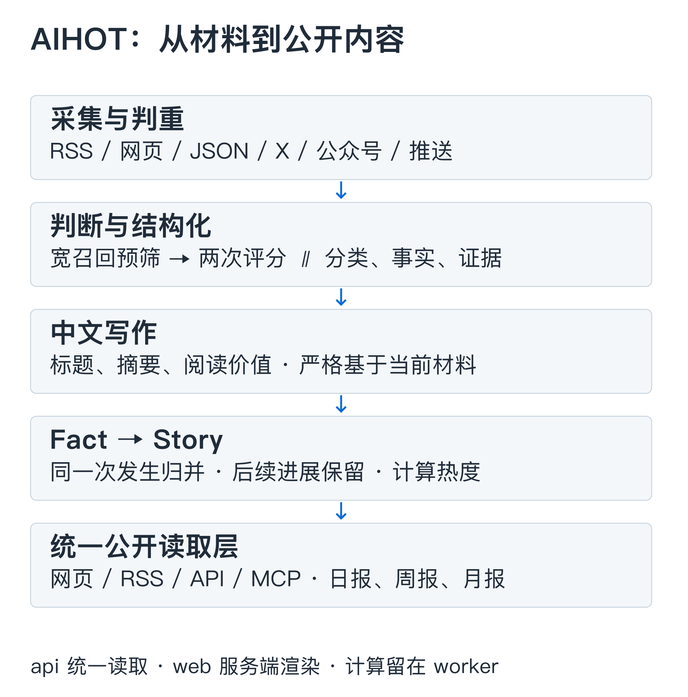
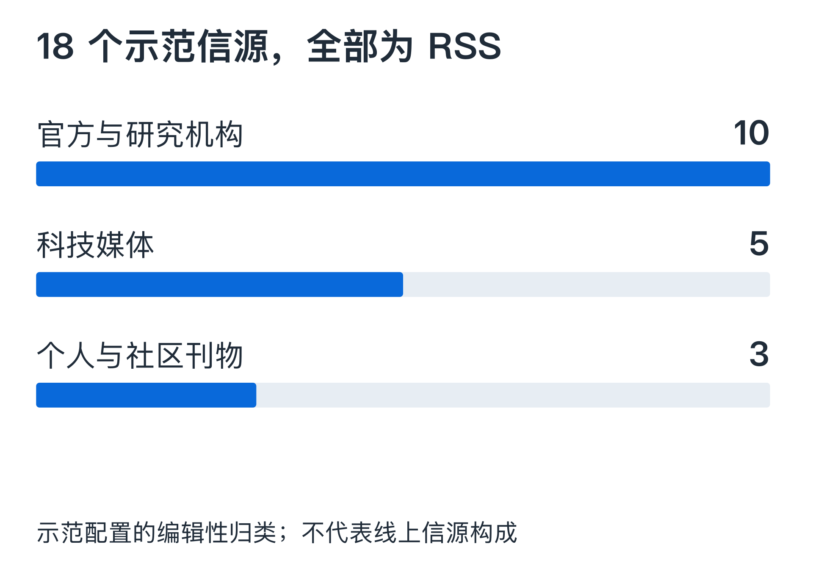
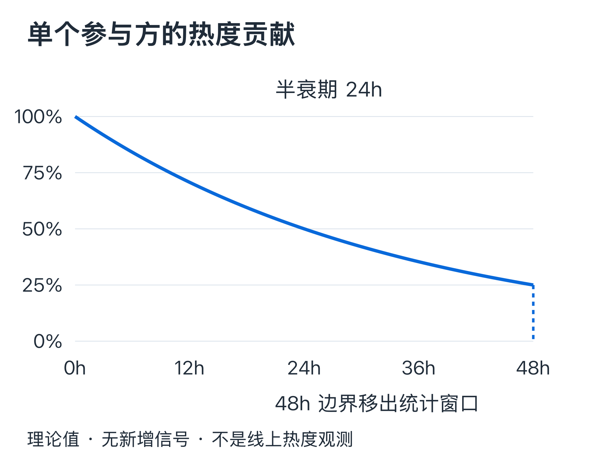

同一款模型发布，官网公告、媒体报道、实测和社交讨论会在一天内涌进信息流。聚合器很容易收齐这些链接，难处在于决定哪些值得看、哪些其实在讲同一件事，以及第二天还有没有必要继续报道。

[AIHOT](https://aihot.news) 把这组编辑判断做成了一条可运行的流水线。它的公开仓库包含采集器、评分标准、写作 Prompt、事件归组、热度算法和出刊规则。沿着一条资料的去向读下去，可以看到一个行业资讯产品怎样把模型判断、确定性规则和人工校正接在一起。

本文核验于 **2026 年 10 月 23 日**，代码基准为 [AIHOT `b3998dc`](https://github.com/KKKKhazix/AIHOT/tree/b3998dc6fc138eb9659f33f55eb38c1c716f0d57)。文中算法、阈值和示范数据均对应这一版本；线上运营信源和模型配置可能另有调整。

<!-- more -->

## 三个进程，分开采集、阅读与计算

AIHOT 使用 Node.js 24、TypeScript、PostgreSQL 和 pg-boss。网页由 React Router 服务端渲染，接口使用 Fastify，样式使用 Tailwind CSS，默认通过 Docker Compose 部署。核心应用有三个长期运行的进程：[架构说明][architecture]。

- **worker** 负责采集、模型分析、事件归组、热度快照、日报和后台维护任务。
- **api** 提供网页接口、公开 API、RSS、MCP、后台管理与图片服务。
- **web** 通过 HTTP 访问 api，负责服务端渲染；它不直接读数据库，也不持有后端的采集凭证。



业务实现集中在 `packages/backend/`；`industry/` 保存信源、分类、Prompt 和入选门槛；`site/` 保存站名、品牌、页面与模型配置。行业经验因此有了明确的落点：改“什么值得看”，主要改行业包；改“如何处理和分发”，才进入引擎。

一个尤其影响成本和可靠性的约束是：**读者打开页面时不调用模型**。标题、摘要、归组和综述提前由 worker 生成，页面读取已存结果。模型服务变慢不会直接把每次阅读都拖进一轮推理。

网页、RSS、API、MCP 和站点地图共用 `publication/` 公开读取层。撤回、全文许可、精选席位和证据资格在这里统一判断。这种设计让“一个内容，多个出口”具备一致的发布边界，而不只是多写几个接口。

## 六类采集器，与 18 个演示信源的边界

引擎支持六种信源：RSS/Atom、网页列表、JSON 列表、X 账号、微信公众号和外部推送。它们对应 `rss`、`web_list`、`json_list`、`x_search`、`mp_account`、`external`。[信源文档][sources] 给出了实际接入方式。

RSS 和 JSON 往往最直接；普通网页列表靠选择器提取，不执行 JavaScript。X 读取使用 SocialData，公众号采集使用 Dajiala，Jina Reader 则是可显式配置的付费读取路径。动态页面在浏览器里可见，并不保证普通 HTML 采集器能拿到内容；RSS、JSON 或外部采集仍是更稳的入口。

公开仓库的 `industry/sources.json` **恰有 18 条示范信源，而且全部是 RSS**。按内容角色可分为下面三组；这是对示范配置的编辑性归类，与引擎的三档信源评级是两套口径。[原始配置][seed]。



官方与研究机构包括 OpenAI News、Google DeepMind、Google Research、Hugging Face、Microsoft Research、NVIDIA、AWS Machine Learning、GitHub AI & ML、Mistral、Berkeley AI Research。媒体包括 The Verge、TechCrunch、Ars Technica、MIT Technology Review 和 The Decoder。其余三条是 Simon Willison、Import AI、Latent Space。

这份名单足够演示产品，但不能代表 AIHOT 线上站的完整采集网络。项目 README 明确说明，真实运营名单与数据没有随引擎开源。线上关于页此次请求返回 403，公开 Agent 入口可以读取；据此无法重核关于页的实时信源数量，本文不沿用旧快照中的总数、分布或覆盖率。

采集也有时间边界。新源首次导入受条数和月份限制；发现时已经发布超过 48 小时的旧文按原文时间归档，不挤入“今天”。没有可信发布时间的普通资料先等待补齐。抓取频率会根据近七天产出调整，相关静默告警还会参考信源自身的历史更新节奏。新文章、刚发现的旧文章与采集失败，被当作三类不同的问题处理。

## 双评分：模型负责估值，代码决定门槛

一条资料先经历网址和内容判重，再经过相关性预筛。预筛 Prompt 只判断 AI 相关性，输出 `PASS`、`BLOCK` 或 `UNKNOWN`：明确无关的资料被拦下，信息不足的保留补材料。普通文章只有标题时，不凭标题评分或生成文案。[预筛原文][prefilter]。

通过后，系统按同一标准独立评分两次，每次输出 0–100 整数。这里的“独立”指两次调用，默认可以是同一个模型；第二次不读取第一次的分数，也没有自动引入另一家模型作交叉验证。[评分调用实现][analysis]。

评分输入刻意去掉来源等级、来源名、旧分数和门槛。模型评估当前材料支持的事件价值，代码再根据来源等级执行筛选。对应规则是：

```text
分数门槛通过 ⇔ 第一次评分 + 第二次评分 ≥ 2 × 对应门槛
页面显示分数 = floor((第一次评分 + 第二次评分) / 2)
```

| 信源档位 | 平均分门槛 | 两次分数之和至少达到 |
| --- | ---: | ---: |
| T1：官方一手 | 60 | 120 |
| T1.5：官方账号、准官方创作者 | 65 | 130 |
| T2：媒体与个人 | 76 | 152 |

源码中的 T1.5 键名为 `T1_5`。未列出阈值的等级不参与精选评分，包括 `EXCLUDE_MP`。显示分数向下取整，真正判定直接比较两次分数之和；因此不能用展示值倒推每次模型给了几分。[门槛配置][thresholds]。

<!-- interactive:aihot-score -->

例如同一材料两次得到 68、72，平均为 70：T1 和 T1.5 达到分数门槛，T2 没有达到。这个例子只检验阈值规则。**达到分数门槛仍不保证进入精选**，后续还要确认事实身份、归组完成和相对已有精选的新增信息。

两次调用可以缓和一次采样的偶然波动，但会保留同一模型、同一标准带来的系统性偏差。平均值也不等于置信度。项目建议用自行标注的样本运行 SelectBench，检查误选、漏选，再调整 Prompt 和阈值；仓库内的示例集不能直接当作准确率证明。

## 评分 Prompt 的核心：五个轴，七套权重

`selection-score.md` 把“注意力价值”拆成五个 0–10 的整数轴：[完整 Prompt][score]。

- `sig`：实质份量，在 AI 时间线上有多重要。
- `nov`：信息增量，带来了什么明确的新事实或方法。
- `cred`：材料内部的证据强度。
- `reson`：与目标读者的共振面。
- `act`：能否用于学习、选择或实际操作。

不同内容用不同权重，各行权重之和为 10，五轴加权后直接落在 0–100。为适应手机阅读，下面把权重写成固定顺序的五元组：**份量 / 增量 / 证据 / 共振 / 可用性**。

| 内容类型 | 五轴权重 |
| --- | --- |
| 模型发布 `model_release` | 3 / 2 / 2 / 2 / 1 |
| 产品更新 `product_launch` | 2 / 2 / 1 / 2 / 3 |
| 方法与 Prompt `tool_or_prompt` | 1 / 2 / 1 / 2 / 4 |
| 论文 `research_paper` | 5 / 3 / 1 / 0 / 1 |
| 行业事件 `industry_event` | 3 / 1 / 2 / 4 / 0 |
| 观点分析 `opinion_analysis` | 1 / 3 / 1 / 4 / 1 |
| 教程解读 `tutorial_explainer` | 1 / 1 / 1 / 3 / 4 |

这套权重体现了明确的编辑取舍：论文要靠实质份量和信息增量，教程要靠可用性，行业事件更看重共振面。它描述了 AIHOT 的目标读者，迁移到金融、法律或科研资讯时，应重新校准。

以下两段直接摘自评分 Prompt：

```text
只评事件值得被看见的程度，不评这篇稿件是否应成为事件的最终代表稿。
相同事件的官方稿、媒体稿、短公告或引用材料会在模型外聚类并选择代表。
```

```text
官方公告足以证明“宣布、上线、降价、开源”这一动作，
但不能自动证明宣传中的效果。
```

Prompt 还规定了抑制噪声的上限：常规功能补齐与平台上架的 `sig ≤ 3`，纯营销与模糊路线图的 `sig ≤ 2`；预告缺乏可验证内容时，`nov ≤ 3` 且 `cred ≤ 4`。标题和正文核心明显冲突，或残缺到辨认不了对象、动作与阶段时，最终分数不得高于 30。

尽管内部使用五轴，**评分接口只允许输出一个字段**：

```json
{"attentionScore": 0}
```

五轴既没有作为模型输出保存，也没有由程序逐项复算。因此它是一份约束模型判断的评分规范，无法仅凭这个 JSON 审计加权是否执行准确。需要可解释性更强的产品时，这会是一个值得改变的接口边界。

## 写作与结构化：原文证据先于流畅文案

评分旁边还有一条并行的结构化任务，抽取分类、标签、主体公司、资料范围，以及“谁、做了什么、对什么、何时”的事实。事实包含原文证据句和影响结论的条件，如可用套餐、地区、免费操作与收费例外。[结构化 Prompt][structure]。

这个步骤特别区分当前动作与背景：今天公布一项评测，不能因为引用了上周的模型发布帖，就再次抽出一条“厂商发布模型”。综合稿的 `fact` 为 `null`，避免把一次大会的多个独立产品拼成虚构事件。条件引用必须是原文中的连续片段，不能用省略号把不同位置拼成一句。

结构化结束后再写中文标题和摘要。达到门槛，或平均分**严格高于 50**的普通资料，使用较完整的内容理解写法；其余使用简短标题摘要路径。无正文或纯链接的 X 原帖保留原链接、图片和引用，不调用写作或翻译模型。[内容理解 Prompt][understanding]。

内容理解与评分分工清晰：写作步骤不能再次打分或决定精选。它输出内容类型、作者角色、标签、候选阅读价值、中文标题和中文摘要。推荐理由只能基于这篇原文，不能从同一事件的其他报道里借事实补进来。

通用防幻觉规则还要求：摘要中的产品名、数字、版本必须能在原文找到；原文只说“正在探索”，不能强化为“已经采用”；没有明确年份，不能擅自给相对时间补年份。输入中的指令和评分暗示统一视作待分析材料。[防幻觉规则][anti-hallucination]。

这些约束能减少失真，效果仍受原文质量和模型执行能力影响。能找到一句原文，只能说明摘要可追溯到这份材料，不能证明原作者的主张已经得到独立验证。

## Fact 与 Story：一次发生，一条演进线

资讯去重最容易在粒度上失手。同一场发布会的五篇报道可以合并，发布后一周出现的实测却仍有阅读价值。AIHOT 用两层结构承接这种差异：[归组规则][grouping]。

**Fact 对应一次具体发生**。例如某公司发布某版本模型，官方公告和两家媒体的转述属于同一 Fact。**Story 对应有直接先后关系的事件演进**，可以包含发布、评测、回应和后续开放等多个 Fact。

| 材料关系 | 系统判断 |
| --- | --- |
| 同一模型发布的官网稿与媒体转述 | `SAME_OCCURRENCE`，同一 Fact |
| 该次发布与随后针对它的实测 | `SAME_STORY`，同一 Story 下不同进展 |
| 同一公司分别发布两个独立产品 | `UNRELATED`，不能只凭公司或日期合并 |
| 一篇周报同时提到多个独立事件 | `ROUNDUP`，分别关联，不把事件互相合并 |

归组先从最近两周的候选事实中召回：配置向量服务时比较向量，否则使用文字重合度。模型再判断关系与信息增量，需要复核的合并在写入前再审一遍，复核模型可单独配置。[关系定义原文][relations]。

误合并比重复链接更难察觉：两个产品被拼到同一事件，摘要可能读起来仍然顺畅。因此项目保留人工归属修正，并避免自动流程覆盖它。归组调用失败或格式错误时，资料不会因等得够久就进入精选；超过等待阈值会告警，留待重试或人工检查。

代表稿另有确定性顺序：官方一手优先；随后是主体匹配、身份已核验的官方或准官方账号；之后再比较全文、评分和时间。网页能把多篇同新闻的报道折成阅读组，API 与 RSS 每条新闻只输出一条代表。评分决定价值，代表稿规则决定读哪篇，两个问题没有混在一次生成里。

## 热度：独立参与方，24 小时半衰期

AIHOT 的热门榜按 Story 计算。当前算法在过去 **48 小时**内，对每个独立参与方保留最新一次有效信号，按 **24 小时半衰期**衰减，再求和。展示指数是这个和的 10 倍，保留一位小数。[算法实现][heat]。

```text
单个参与方权重 = 0.5 ^ (信号年龄小时数 / 24)
热度指数 = round(10 × 所有有效参与方权重之和，1 位小数)
有效窗口：信号年龄严格小于 48 小时
```



图中画的是**没有新增信号时的理论衰减**，并非 AIHOT 线上热榜的观测数据。静态数值为：0 小时 100%、12 小时约 70.7%、24 小时 50%、36 小时约 35.4%；48 小时之前约 25%，到达窗口边界便移出统计。同一参与方出现新信号会更新计时。

这里的“独立参与方”比“不同网站”更严格。配置了 `owner_entity_id` 的公司渠道会合并，同一运营方的媒体矩阵可用 `signal_group_id` 合并，指定的社区源则可以按作者计数。重复抓取不增加贡献，一家公司在几个自有渠道发稿也不会简单算成几个独立声音；这个效果依赖正确的来源身份配置。

热门榜最多取 10 个事件，至少需要两个参与方且至少一个编辑型参与方。X 等氛围信号可以贡献热度，无法单独撑起一个没有编辑型证据的热榜条目。与六小时前比较时，系统还会剔除未完整观测的参与方，避免新增信源或采集延迟制造虚假的涨幅。

因此热度衡量的是**已配置采集网络里，近期有多少独立参与方在持续谈论这件事**。它不等同于全网流行度、阅读量或事实真伪，也不直接使用模型的精选评分作乘数。

## 日报：先确定席位，再决定文字

当前日报默认每天 08:00 出刊，覆盖前一天 08:00 到当天 08:00，**按规则编排，不调用模型**。出刊时间属于站点配置，并非不可更改的产品约束。[出刊规则][selection]。

日报一件事占一个条目；最近七期报过的事件只在有合格新进展时跟进。前 12 条进入正文，同一信源最多两条，后面最多十条一行快讯。头条和看点从已有条目中产生。官方新动作和报道面会影响跟进资格，少量未进入精选、却有官方原帖与足够独立参与方的事件也有补入日报的路径。

周报和月报再从日报汇编：同一事件跨天合并，周报取前 20 件、月报取前 30 件。模型只写总述和满足条件的栏目导读，不决定增删条目。这样，选题席位仍可追溯到已出刊的日报，生成文字集中在较小的范围里。

一个容易过时的描述是“AI 自动写日报”。它省略了真正决定结果的部分：来源资格、去重、历史刊载状态、条目上限、跟进条件和排序。当前实现把这些工作交给规则，让出刊结果更容易解释和重放。

## 模型与成本：一次处理，往往不止一次调用

公开配置支持 OpenAI 兼容接口。`.env.example` 使用 `deepseek-flash`；`site/models.ts` 也列出智谱、千问、MiMo 等具名预设，但当前 `DEFAULTS` 是空对象，未指定的步骤沿用环境变量所配模型。模型名称存在于预设中，并不能证明线上正在使用它。[模型配置][models]。

处理一条新资料可能包括一次预筛、两次评分、一次结构化、一次写作；遇到相近报道还要做归组、复核、事件综述，部分精选另有全文翻译。空正文与纯链接原帖有跳过写作的例外，缓存命中和拒答也会改变次数。

部署文档记录过一次示范导入：152 条资料约 930 次模型调用，相当于每条约 6.1 次。这是**上游披露的一次试跑结果**，本文没有重跑计费实验；它不能外推为固定的每日用量或线上账单。[成本说明][cost]。

估算费用至少需要区分以下三部分：模型各步骤的输入、输出及推理 token；X、公众号、Jina 等付费采集请求；数据库、存储、图片与带宽等运行费用。相同文章数可能因正文长度、归组密度、翻译比例和模型价格产生很大差距，单用“每篇几分钱”会掩盖这些变量。

可复用的节流思路包括宽召回预筛、分档写作、按步骤选模型、复用已付费结果，以及把页面读取与推理分离。双评分增加了调用量；是否值得，最终要看标注集上误选和漏选的改善。

## 可靠性做到了哪里，边界又在哪里

AIHOT 用 pg-boss 管理后台任务，并为模型与付费采集记录请求回执：发出前记账，结果到达后先存再用，重试时复用已完成的付费结果。它还提供按分钟、小时、天的调用上限，以及采集和模型调用开关。[可靠性约束][architecture]。

这些机制降低了任务重启造成重复计费的概率，但不构成外部服务的“恰好一次”保证。请求结果不明的回执，超过 30 分钟可以自动放行一次；若先前请求实际成功，仍存在再次付费的可能。运行日志、人工核对和预算限制仍有必要。

对内容产品，更长期的风险集中在四处：

**覆盖偏差。** 演示源偏英语官方与科技媒体；真实覆盖取决于额外接入的名单。没有采到的新闻，再好的评分也无从判断。

**价值偏差。** 五轴与阈值服务特定读者。官方身份对应较低入选门槛，不能据此把营销主张当作事实；同模型双评分也无法消除共同偏差。

**归组与时间偏差。** 最近两周召回可能漏掉更久的前因；同主体、同产品的多次动作容易误合并。错误发布日期和渠道身份配置又会影响归档、热度与日报。

**证据与授权边界。** Prompt injection 防护和连续引文校验无法替代事实核查。全文默认不公开，站内全文与全文 RSS 分别受 `site_fulltext`、`syndicate_fulltext` 控制；抓得到的内容仍需符合转载许可。

README 展示的页面与接口耗时属于项目方公布的线上测量。没有统一的机器、负载、样本和网络条件，无法把这些数字作为自部署实例的性能承诺。本文仅审查公开实现，没有启动付费采集、调用模型或复现线上负载。

## 这套引擎最值得带走的设计

AIHOT 把“资讯值得看”拆成几个可以分别校准的判断：材料相关吗、事件重要吗、是不是同一次发生、有没有新信息、该读哪篇、今天该不该再报。每个判断有自己的输入、Prompt 或确定性规则，错误也就有了相对明确的排查入口。

其中几项设计具备较强的迁移价值：行业判断放进版本化 Prompt 和门槛；Fact 与 Story 分开，既压缩重复报道又保留演进；热度按独立参与方计算，显式处理来源身份；公开读取层统一多渠道的撤回与许可；先确定日报席位，再生成有限的导读文字；把每一次付费调用变成可恢复、可核对的工作记录。

搭建另一个行业的热点站，真正需要积累的是可信信源、读者价值标准和标注样本。引擎提供了把这些经验写成规则、运行并持续校正的框架。代码使用 MIT 许可证，AIHOT 的名字与 Logo 则不在授权范围内，衍生站应使用自己的品牌。

## 源码与核验入口

以下链接固定到本文审查的 commit，避免上游改动后正文与引用错位。网页现状以访问日期为准。

1. [架构、模块边界与可靠性约束][architecture]。
2. [18 个演示信源的完整配置][seed]；[六类采集器及抓取规则][sources]。
3. [预筛 Prompt][prefilter]；[评分 Prompt 全文][score]；[双评分调用与判定][analysis]；[门槛配置][thresholds]。
4. [结构化 Prompt][structure]；[内容理解 Prompt][understanding]；[防幻觉规则][anti-hallucination]。
5. [关系定义][relations]；[归组与评测说明][grouping]；[热度实现][heat]。
6. [精选、日报与周月报规则][selection]；[模型配置][models]；[试跑调用量与成本说明][cost]。
7. [开源范围与许可证说明](https://github.com/KKKKhazix/AIHOT/blob/b3998dc6fc138eb9659f33f55eb38c1c716f0d57/README.md)；[线上公开 Agent 入口](https://aihot.news/api/v1/agent)；[线上关于页](https://aihot.news/about)（本次访问返回 403）。

[architecture]: https://github.com/KKKKhazix/AIHOT/blob/b3998dc6fc138eb9659f33f55eb38c1c716f0d57/docs/architecture.md
[sources]: https://github.com/KKKKhazix/AIHOT/blob/b3998dc6fc138eb9659f33f55eb38c1c716f0d57/docs/sources.md
[seed]: https://github.com/KKKKhazix/AIHOT/blob/b3998dc6fc138eb9659f33f55eb38c1c716f0d57/industry/sources.json
[prefilter]: https://github.com/KKKKhazix/AIHOT/blob/b3998dc6fc138eb9659f33f55eb38c1c716f0d57/industry/prompts/prefilter.md
[score]: https://github.com/KKKKhazix/AIHOT/blob/b3998dc6fc138eb9659f33f55eb38c1c716f0d57/industry/prompts/selection-score.md#L32-L54
[analysis]: https://github.com/KKKKhazix/AIHOT/blob/b3998dc6fc138eb9659f33f55eb38c1c716f0d57/packages/backend/src/editorial/analyze.ts#L270-L312
[thresholds]: https://github.com/KKKKhazix/AIHOT/blob/b3998dc6fc138eb9659f33f55eb38c1c716f0d57/industry/selection.ts#L7-L19
[structure]: https://github.com/KKKKhazix/AIHOT/blob/b3998dc6fc138eb9659f33f55eb38c1c716f0d57/industry/prompts/structure.md
[understanding]: https://github.com/KKKKhazix/AIHOT/blob/b3998dc6fc138eb9659f33f55eb38c1c716f0d57/industry/prompts/content-understanding.md
[anti-hallucination]: https://github.com/KKKKhazix/AIHOT/blob/b3998dc6fc138eb9659f33f55eb38c1c716f0d57/industry/prompts/rules-anti-hallucination.md
[grouping]: https://github.com/KKKKhazix/AIHOT/blob/b3998dc6fc138eb9659f33f55eb38c1c716f0d57/docs/grouping.md
[relations]: https://github.com/KKKKhazix/AIHOT/blob/b3998dc6fc138eb9659f33f55eb38c1c716f0d57/industry/prompts/group-definitions.md
[heat]: https://github.com/KKKKhazix/AIHOT/blob/b3998dc6fc138eb9659f33f55eb38c1c716f0d57/packages/backend/src/events/hot.ts#L109-L205
[selection]: https://github.com/KKKKhazix/AIHOT/blob/b3998dc6fc138eb9659f33f55eb38c1c716f0d57/docs/selection.md
[models]: https://github.com/KKKKhazix/AIHOT/blob/b3998dc6fc138eb9659f33f55eb38c1c716f0d57/site/models.ts
[cost]: https://github.com/KKKKhazix/AIHOT/blob/b3998dc6fc138eb9659f33f55eb38c1c716f0d57/docs/deploy.md#L243-L247
